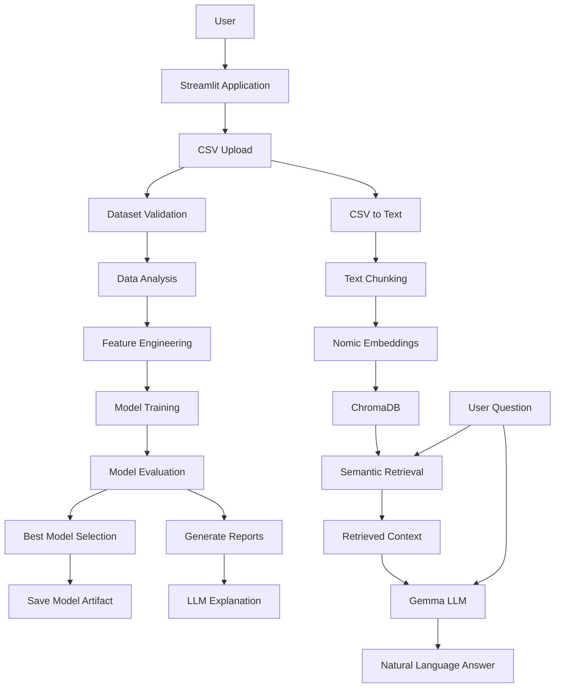
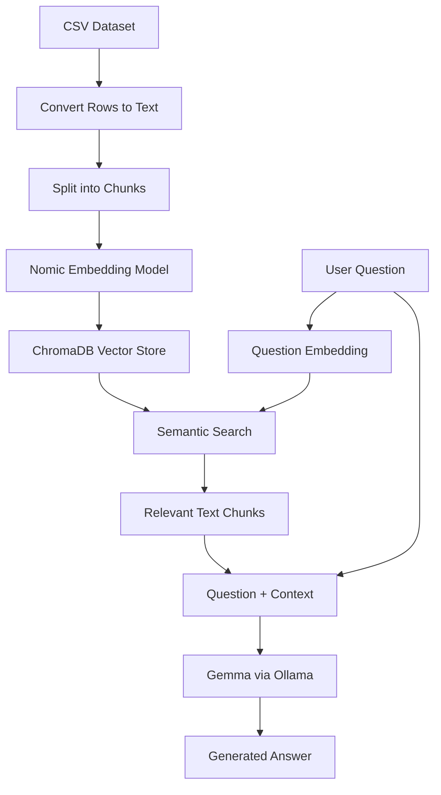

# 🤖 AutoML AI Agents — Intelligent Machine Learning & RAG Assistant

An AI-powered AutoML application that automates key machine learning workflows, compares multiple models, generates performance reports, and uses Large Language Models (LLMs) to explain results in simple, understandable language.

The project also incorporates a Retrieval-Augmented Generation (RAG) pipeline to explore dataset information and retrieve relevant context from indexed data and reports.

> **Project goal:** Make machine learning experimentation more accessible by combining automated model training, performance evaluation, report generation, and natural-language interaction in one application.

---

## 📌 Table of Contents

1. [Project Overview](#-project-overview)
2. [Problem Statement](#-problem-statement)
3. [Key Features](#-key-features)
4. [Technology Stack](#-technology-stack)
5. [System Architecture](#-system-architecture)
6. [How the AutoML Workflow Works](#-how-the-automl-workflow-works)
7. [Understanding the RAG Pipeline](#-understanding-the-rag-pipeline)
8. [Machine Learning Models and Evaluation](#-machine-learning-models-and-evaluation)
9. [Project Structure](#-project-structure)
10. [Installation and Setup](#-installation-and-setup)
11. [Environment Configuration](#-environment-configuration)
12. [Running the Application](#-running-the-application)
13. [Using the Application](#-using-the-application)
14. [Generated Reports and Model Artifacts](#-generated-reports-and-model-artifacts)
15. [Example Results](#-example-results)
16. [Limitations and Future Improvements](#-limitations-and-future-improvements)
17. [Learning Outcomes](#-learning-outcomes)
18. [Contributing](#-contributing)
19. [License](#-license)

---

## 🚀 Project Overview

AutoML AI Agents is a Python-based machine learning application designed to simplify the process of building and evaluating predictive models.

Traditional machine learning workflows often require users to perform several steps manually:

- Inspect and understand a dataset.
- Validate the data and identify potential issues.
- Prepare features for model training.
- Select appropriate machine learning algorithms.
- Train and compare multiple models.
- Evaluate model performance using suitable metrics.
- Save the trained model and generate reports.
- Interpret results and communicate findings.

This project organizes these activities into an automated workflow using **LangGraph**, Python-based machine learning libraries, and an interactive Streamlit interface.

It also explores the integration of **Retrieval-Augmented Generation (RAG)**, allowing users to ask questions about indexed dataset information and AutoML reports using natural language.

The application combines traditional machine learning with local language models to make results easier to understand without requiring every explanation to depend on a paid external LLM API.

### 🎯 Main Objectives

- Automate repetitive machine learning tasks.
- Organize the ML pipeline into modular, reusable components.
- Compare multiple candidate models using evaluation metrics.
- Generate structured reports and save trained model artifacts.
- Explain model results using an LLM.
- Retrieve relevant information from datasets and reports through RAG.
- Provide an accessible interface for users with limited ML experience.

---

## ❗ Problem Statement

Building a reliable machine learning solution involves more than training a model. Data preparation, model selection, evaluation, experiment tracking, and result interpretation can be time-consuming, particularly for beginners and small teams.

Furthermore, numerical evaluation reports are not always easy for non-technical users to interpret.

**Proposed solution:** Develop an application that automates important stages of the ML workflow, compares model performance, generates reports, and provides a natural-language interface for understanding the resulting information.

The application aims to reduce repetitive work while keeping the underlying ML process visible and understandable.

---

## ✨ Key Features

### 1. Automated Machine Learning Workflow

- Upload and inspect CSV datasets.
- Select a prediction task, such as regression or classification.
- Specify the target column.
- Execute the ML workflow through a coordinated pipeline.
- Train and evaluate multiple candidate models.
- Compare model performance using relevant metrics.
- Identify the selected model according to the configured selection metric.
- Save the trained model artifact.

### 2. Modular AI Agent Architecture

The project separates major responsibilities into dedicated modules.

- **Validator Agent:** Handles dataset validation.
- **Data Analyst Agent:** Performs dataset analysis.
- **Feature Engineer Agent:** Handles feature preparation and engineering.
- **Model Trainer Agent:** Trains and evaluates candidate models.
- **LLM Explainer Agent:** Generates natural-language explanations of ML results.

LangGraph is used to coordinate the workflow and manage the shared state between its components.

### 3. Interactive Streamlit Dashboard

The Streamlit application provides a user interface for:

- Uploading datasets.
- Inspecting dataset previews and column information.
- Launching AutoML experiments.
- Reviewing model metrics.
- Comparing candidate models.
- Viewing AI-generated explanations.
- Accessing generated reports.
- Interacting with RAG-based assistants.

### 4. Model Comparison and Evaluation

The application evaluates multiple models and presents their results in a structured format.

For regression tasks, supported evaluation metrics include:

- Mean Absolute Error (MAE).
- Root Mean Squared Error (RMSE).
- Coefficient of Determination (R²).

The configured selection metric determines which model is selected. Metric choice should be appropriate for the prediction task and business objective.

### 5. RAG-Based CSV Question Answering

The CSV RAG component is designed to let users ask natural-language questions about information contained in an indexed dataset.

The intended pipeline is:

`CSV → Text → Chunks → Embeddings → ChromaDB → Retrieval → LLM Answer`

Core components:

- Pandas for reading CSV data.
- LangChain text splitters for chunking.
- Nomic Embed Text for generating embeddings locally.
- ChromaDB for vector storage and semantic retrieval.
- Gemma 3 1B through Ollama for natural-language responses.

The CSV indexing and retrieval components are being integrated and tested. Exact calculations over an entire dataset, such as total revenue or the absolute maximum value, require additional full-dataset computation and should not be assumed to be reliably answered by semantic retrieval alone.

### 6. Report-Based RAG Assistant

The project also includes a separate report retrieval workflow intended to answer questions using generated AutoML reports.

Report sources include:

- `analysis_report.txt`
- `analysis_report.json`
- `model_comparison.json`

The report indexing component converts available report content into chunks, generates embeddings, and stores them in ChromaDB for retrieval.

### 7. Local LLM Integration

The project uses Ollama to run language models locally.

- **Gemma 3 1B:** Natural-language explanation and question answering.
- **Nomic Embed Text:** Text embeddings for semantic search.

Local inference can reduce dependence on external API providers. However, performance depends on available hardware, model capabilities, and the size of the input context.

---

## 🛠️ Technology Stack

| Category | Technologies |
|---|---|
| Programming language | Python |
| Frontend and dashboard | Streamlit |
| ML and data processing | Pandas, NumPy, scikit-learn |
| Workflow orchestration | LangGraph |
| LLM integration | LangChain |
| Local model runtime | Ollama |
| Language model | Gemma 3 1B |
| Embedding model | Nomic Embed Text |
| Vector database | ChromaDB |
| Model serialization | Joblib |
| Configuration | python-dotenv |
| Data input | CSV |
| Reporting | JSON, TXT |

*The exact package versions and additional dependencies should be recorded in `requirements.txt`.*

---

## 🏗️ System Architecture

The application contains two related but distinct workflows: the AutoML pipeline and the RAG pipeline.

### Overall Architecture



### Architecture Explanation

**1. Presentation layer**

Streamlit provides the user interface for uploading datasets, initiating workflows, and viewing results.

**2. Workflow orchestration layer**

LangGraph coordinates the AutoML agents and passes shared state between workflow steps.

**3. Machine learning layer**

Pandas and scikit-learn handle data processing, model training, and evaluation.

**4. Persistence layer**

Joblib stores the trained model, while JSON and TXT files store reports. ChromaDB stores vector representations and associated text for retrieval.

**5. Language model layer**

Ollama runs the local LLM and embedding model. LangChain connects these models to the application.

---

## 🔄 How the AutoML Workflow Works

### Step 1: Dataset Input

The user uploads a CSV dataset and selects the prediction task and target column.

The application reads the dataset into a Pandas DataFrame.

### Step 2: Dataset Validation

The validation component checks whether the dataset is suitable for processing and identifies potential data-quality issues.

The exact validation rules depend on the implementation.

### Step 3: Dataset Analysis

The analysis component examines dataset characteristics and prepares information that can help guide later processing.

Examples of useful analysis include:

- Number of rows and columns.
- Column data types.
- Missing values.
- Numerical summaries.
- Target-column characteristics.

### Step 4: Feature Engineering

The feature engineering component prepares input features for model training.

Typical responsibilities may include handling categorical features, missing values, and transformations needed by the selected algorithms. The actual transformations depend on the current implementation.

### Step 5: Model Training

The model trainer fits multiple candidate models on the prepared training data.

For example, a regression workflow can compare Linear Regression, Ridge Regression, and Random Forest Regression.

### Step 6: Model Evaluation

The trained models are evaluated using the configured metrics.

For regression:

- Lower MAE generally indicates smaller average absolute prediction errors.
- Lower RMSE generally indicates smaller errors while penalizing larger errors more strongly.
- Higher R² generally indicates that the model explains more of the target variance on the evaluation dataset.

### Step 7: Model Selection

The application selects a model according to the configured selection metric.

The selected model is saved as a Joblib artifact for later use.

### Step 8: Reporting and Explanation

The application generates structured reports containing relevant information about the dataset and model comparisons.

The LLM explainer can use the training result and available report tools to explain the results in simple language.

---

## 🧠 Understanding the RAG Pipeline

Retrieval-Augmented Generation combines information retrieval with a language model.

Instead of relying only on the model's internal knowledge, the system retrieves relevant text from a vector database and provides that text as context for generating an answer.

### RAG Indexing Phase

**Step 1 — Read CSV**

Pandas loads the uploaded dataset.

**Step 2 — Convert rows into text**

Each record is converted into readable text containing column names and values.

Example:

```text
Product: Laptop
Category: Electronics
Price: 55000
Rating: 4.5
```

**Step 3 — Split the text into chunks**

Long text is divided into smaller sections so that retrieval can focus on relevant information.

**Step 4 — Generate embeddings**

Nomic Embed Text converts each chunk into a numerical vector representing aspects of its semantic meaning.

**Step 5 — Store the vectors**

ChromaDB stores the chunks, their embeddings, and associated metadata.

### RAG Query Phase

**Step 1:** The user asks a question, such as:

> What information is available about the laptop product?

**Step 2:** The embedding model converts the question into a vector.

**Step 3:** ChromaDB searches for semantically similar chunks.

**Step 4:** The retrieved text is combined with the original question.

**Step 5:** Gemma receives the context and generates a natural-language answer.

### RAG Flow



### Important Limitation of Basic RAG

Semantic retrieval finds relevant text; it does not automatically calculate accurate statistics over every row.

For example, questions such as these may require full-dataset computation:

- What is the total revenue?
- Which product has the highest price in the entire dataset?
- What is the average sales value?
- How many records satisfy a condition?

If the relevant record or all necessary values are not retrieved, basic RAG may produce an incomplete or incorrect answer.

A future improvement is to combine RAG with Pandas or SQL tools for exact calculations, while keeping RAG for semantic lookup and explanations.

---

## 📊 Machine Learning Models and Evaluation

The project is designed to compare multiple candidate models rather than assuming one algorithm will always perform best.

### Example Regression Models

| Model | General purpose |
|---|---|
| Linear Regression | Establishes a linear baseline |
| Ridge Regression | Adds L2 regularization to linear regression |
| Random Forest Regression | Combines predictions from multiple decision trees |

### Evaluation Metrics

| Metric | Meaning | Preferred direction |
|---|---|---|
| MAE | Average absolute prediction error | Lower |
| RMSE | Square root of average squared prediction error | Lower |
| R² | Relative explanatory performance on evaluation data | Generally higher |

Metric values depend on the dataset, target variable, train/test split, preprocessing, and model configuration.

A high R² does not guarantee strong performance on unseen real-world data. Reliable evaluation requires appropriate validation, leakage prevention, and testing on data not used for model selection.

---

## 📁 Project Structure

The following structure describes the main modules currently associated with the project. Confirm the actual files in your repository before publishing this tree.

```text
automl-ai-agents/
│
├── agents/
│   ├── validator.py
│   ├── data_analyst.py
│   ├── feature_engineer.py
│   ├── model_trainer.py
│   └── llm_explainer.py
│
├── graph/
│   └── workflow.py
│
├── state/
│   └── ml_state.py
│
├── tools/
│   └── report_tools.py
│
├── rag/
│   ├── vector_store.py
│   ├── rag_chain.py
│   ├── csv_indexer.py
│   └── csv_qa.py
│
├── data/
│   └── sample.csv
│
├── models/
│   └── best_model.joblib
│
├── reports/
│   ├── analysis_report.txt
│   ├── analysis_report.json
│   └── model_comparison.json
│
├── chroma_db/
│
├── app.py
├── main.py
├── requirements.txt
├── .env.example
├── .gitignore
└── README.md
```

**Folder responsibilities**

- `agents/`: Modular components responsible for ML workflow tasks.
- `graph/`: LangGraph workflow orchestration.
- `state/`: Shared state definition.
- `tools/`: Functions exposed to the LLM explainer.
- `rag/`: Report indexing, CSV indexing, retrieval, and question answering.
- `data/`: Sample input data.
- `models/`: Generated model artifacts.
- `reports/`: Generated analysis and model comparison reports.
- `chroma_db/`: Local vector database persistence.
- `app.py`: Interactive Streamlit interface.
- `main.py`: Command-line or programmatic workflow entry point, depending on its implementation.

---

## ⚙️ Installation and Setup

### Prerequisites

Install the following before running the application:

- Python 3.11 or another Python version compatible with the project's dependencies.
- Git.
- Ollama.
- A machine with sufficient memory and compute resources for the selected models.

### Step 1: Clone the Repository

```bash
git clone <YOUR_GITHUB_REPOSITORY_URL>
cd automl-ai-agents
```

Replace the placeholder with your actual GitHub repository URL after publishing.

### Step 2: Create a Virtual Environment

**Windows PowerShell**

```powershell
py -3.11 -m venv .venv
.\.venv\Scripts\Activate.ps1
```

If Python 3.11 is not installed, install a compatible version and verify it using:

```powershell
py --list
```

### Step 3: Install Dependencies

```powershell
python -m pip install --upgrade pip
pip install -r requirements.txt
```

Ensure that `requirements.txt` contains the packages actually imported by the project.

### Step 4: Install and Start Ollama

Install Ollama from its official website:

https://ollama.com/

Download the required local models:

```powershell
ollama pull gemma3:1b
ollama pull nomic-embed-text
```

Check the installed models:

```powershell
ollama list
```

Test the embedding model:

```powershell
ollama run nomic-embed-text
```

Test the LLM:

```powershell
ollama run gemma3:1b
```

Ollama must be running when the application requests local inference.

### Step 5: Configure Environment Variables

Create a `.env` file in the project root if your application uses environment variables.

Example:

```env
OLLAMA_MODEL=gemma3:1b
```

Additional variables may be needed depending on the implementation.

Never commit API keys, passwords, or private credentials to GitHub.

### Step 6: Run the Application

```powershell
streamlit run app.py
```

Streamlit will display the local application address in the terminal.

---

## 🔐 Environment Configuration

The project can use local Ollama models for LLM explanations and embeddings, reducing the need for an external LLM API key for those operations.

If other modules still use Groq, their configuration must be handled separately until they are migrated to Ollama.

Use `.env.example` to document required configuration without exposing secrets.

Example:

```env
# Local LLM configuration
OLLAMA_MODEL=gemma3:1b

# Configure only if the current code still requires Groq
# GROQ_API_KEY=your_key_here
# GROQ_MODEL=your_model_name
```

The actual variables must match the environment variables read by the code.

---

## 🖥️ Using the Application

### Overview

1. Launch the Streamlit application.
2. Upload a CSV dataset.
3. Inspect the dataset preview and column information.
4. Select the appropriate ML task and target column.

### AutoML Workspace

1. Start the AutoML workflow.
2. Wait for validation, analysis, feature processing, and model training.
3. Review model evaluation metrics.
4. Compare candidate models.
5. Inspect the selected model and AI explanation.
6. Review generated reports.

### CSV AI Analyst

1. Open the CSV AI Analyst section.
2. Build or refresh the CSV index.
3. Wait for indexing to complete.
4. Ask a natural-language question.
5. Review the retrieved-context-based answer and available source information.

The CSV assistant requires successful indexing before retrieval can work.

### Reports and Assistant

1. Generate the AutoML reports by running the workflow.
2. Index the available reports.
3. Ask questions about dataset analysis or model comparison results.
4. Review the answer and its source references.

The assistant's answers depend on the information present in the reports and the reliability of retrieval and generation.

---

## 📄 Generated Reports and Model Artifacts

The application can generate artifacts such as:

### `analysis_report.txt`

A readable report describing dataset analysis.

### `analysis_report.json`

A structured representation of dataset analysis results.

### `model_comparison.json`

Structured information about the candidate models, their evaluation metrics, and model-selection results.

### `best_model.joblib`

A serialized model artifact produced by the model-training workflow.

Generated reports and models should be treated as experiment outputs, not source code. Their contents may vary between runs and datasets.

Avoid committing large, private, or dataset-specific artifacts unless they are intentionally included as public examples.

---

## 📈 Example Results

The following is an example of an observed regression experiment. It illustrates the format of the application's model comparison results; it is not a benchmark or a guarantee of performance on other datasets.

| Model | MAE | RMSE | R² |
|---|---:|---:|---:|
| Linear Regression | 181,449.50 | 414,087.96 | 0.7795 |
| Ridge Regression | 188,093.40 | 419,975.22 | 0.7732 |
| Random Forest Regression | 99,581.80 | 237,859.32 | 0.9273 |

**Interpretation**

- Random Forest achieved the highest R² among the three models in this experiment.
- It also produced the lowest MAE and RMSE.
- Under these observed results, Random Forest was the strongest candidate among the evaluated models.
- The results do not establish how the model will perform on future or out-of-distribution data.

Actual results will vary according to the dataset, preprocessing, evaluation methodology, and model configuration.

---

## ⚠️ Limitations and Future Improvements

### Current Considerations

- Model performance depends on dataset quality and evaluation methodology.
- The local LLM may generate incomplete explanations or struggle with tool calling.
- RAG quality depends on chunking, embeddings, retrieval settings, and the supplied context.
- Basic semantic retrieval is not a replacement for exact full-dataset calculations.
- Large CSV files may require more memory, processing time, and vector storage.
- The local LLM and embedding models must be installed and available.
- CSV indexing and RAG features should be tested end to end before being described as production-ready.

### Planned Improvements

- [ ] Add automated tests for the complete ML workflow.
- [ ] Improve CSV indexing error handling and recovery.
- [ ] Support reliable dataset-specific index refresh and cleanup.
- [ ] Improve retrieval quality and expose source references more clearly.
- [ ] Integrate Pandas-based tools for exact calculations over the full dataset.
- [ ] Add support for more ML algorithms and configurable hyperparameter search.
- [ ] Add cross-validation and stronger leakage prevention.
- [ ] Track experiments and model versions.
- [ ] Add downloadable reports and predictions.
- [ ] Improve logging, configuration, and exception handling.
- [ ] Add Docker-based setup and deployment documentation.
- [ ] Add automated CI checks through GitHub Actions.

These are planned enhancements and should not be interpreted as completed features.

---

## 🎓 Learning Outcomes

This project provides practical experience with:

- Building machine learning pipelines in Python.
- Using Pandas and scikit-learn for data processing and predictive modelling.
- Comparing models with appropriate evaluation metrics.
- Designing modular components for an ML application.
- Using LangGraph for workflow orchestration.
- Integrating language models with application logic.
- Implementing a RAG pipeline with embeddings and vector retrieval.
- Working with local LLMs through Ollama.
- Building interactive data applications with Streamlit.
- Managing reports, serialized models, dependencies, and environment configuration.
- Debugging integration issues across machine learning and LLM components.

---

## 🤝 Contributing

Contributions, bug reports, and suggestions are welcome.

To contribute:

1. Fork the repository.
2. Create a feature branch.
3. Make your changes.
4. Test the affected components.
5. Submit a pull request describing the changes.

Please avoid committing API keys, private datasets, virtual environments, or local database artifacts.

---

## 📜 License

Choose a suitable open-source license before publishing this project. If you want others to use, modify, and redistribute your code, consider adding an MIT License in a separate `LICENSE` file.

Do not claim that the project is MIT-licensed until that license has actually been added.

---

## 👨‍💻 Author

**Adnan Alam**

B.Tech in Information Technology

Interested in Machine Learning, Generative AI, RAG Systems, AI Agents, and Full-Stack Development.

- GitHub: `https://github.com/GeekyAdnan125/`
- LinkedIn: `https://www.linkedin.com/in/adnan-alam-6a3351284/`


---

## ⭐ Support

If you find this project useful, consider giving the repository a star ⭐ and sharing feedback or improvement suggestions.

**Built to explore how automated machine learning and retrieval-augmented generation can work together in a practical application.**
